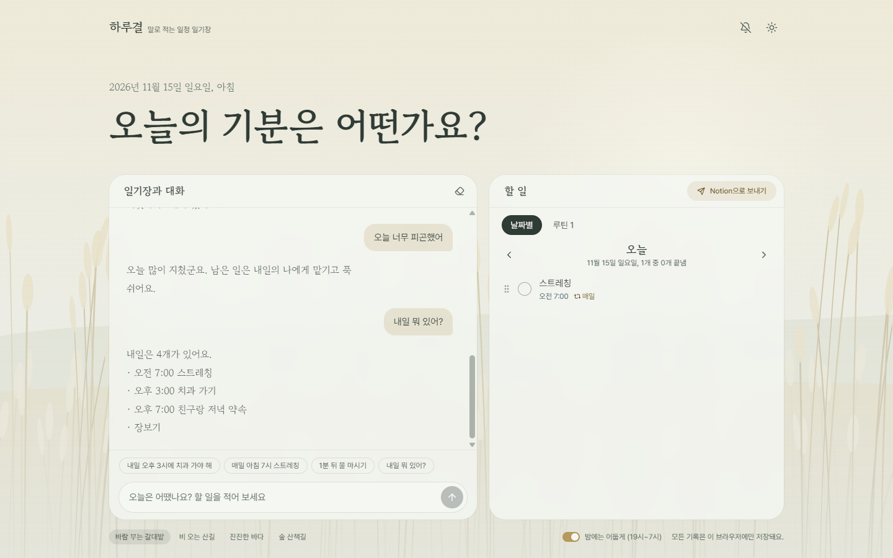
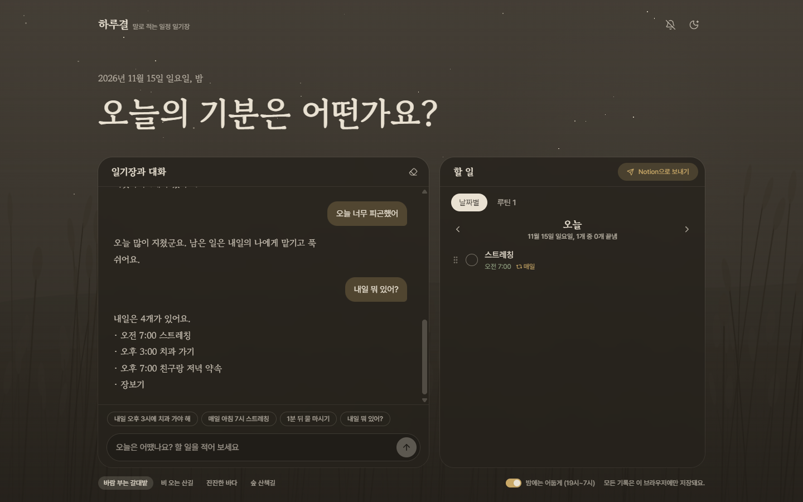

# 하루결 · 말로 적는 일정 일기장

> "내일 오후 3시에 치과 가야 해"라고 적으면, 일기장이 알아듣고 일정에 옮겨 적어 줍니다.

할 일 앱은 보통 입력 칸, 날짜 선택기, 시간 선택기를 차례로 거쳐야 합니다. 하루결은 이 과정을 대화 한 줄로 줄여 보려고 만든 개인 프로젝트입니다. React로 상태 관리와 컴포넌트 설계를 공부하면서 클론 코딩 정도의 규모 안에서 직접 기획하고 디자인하고 구현했습니다.

| 라이트 모드 | 다크 모드 (등잔불 아래 일기장) |
| --- | --- |
|  |  |

## 주요 기능

- **대화로 일정 추가**: 날짜(오늘·내일·다음 주 월요일·12월 3일·3일 뒤), 시간(오후 3시·9시 반·저녁), 반복(매일·평일·매주 수요일)을 문장에서 읽어 냅니다.
- **대화로 일정 조회**: "내일 뭐 있어?"라고 물으면 그날 할 일을 시간순으로 정리해 답하고 같은 시간에 일정이 겹치면 함께 알려 줍니다.
- **드래그 앤 드롭 정렬**: 마우스, 터치, 키보드(스페이스바와 방향키) 어느 쪽으로든 순서를 바꿀 수 있습니다.
- **할 일과 루틴 분리**: 날짜별 탭에서는 그날의 일정과 루틴을, 루틴 탭에서는 반복하는 일만 모아서 봅니다.
- **테마 전환**: 라이트, 다크, 기기 설정 따르기 중에 고를 수 있습니다.
- **알림**: 정해 둔 시간이 되면 화면 안 토스트와 브라우저 알림을 띄웁니다. "1분 뒤 물 마시기"로 바로 시험해 볼 수 있습니다.
- **Notion으로 보내기**: 연결부터 전송까지의 흐름을 데모로 구현했고 실제로 동작하는 마크다운 복사 기능도 넣었습니다.
- **분위기 있는 첫 화면**: 질문 문구가 5초마다 바뀌고 직접 SVG로 그린 자연 풍경 네 가지(갈대밭, 비 오는 산길, 바다, 숲길)가 천천히 번갈아 나옵니다.
- **시간 따라 바뀌는 하늘**: 새벽, 아침, 낮, 해 질 녘, 밤마다 배경의 빛이 달라지고 밤에는 별이 뜹니다. 날짜 옆에 연도와 지금 시간대도 함께 적힙니다. 주소 뒤에 `?hour=21`처럼 시각을 붙이면 다른 시간대를 미리 볼 수 있습니다.
- **밤에는 자동으로 어둡게**: 평소에는 사용자가 고른 테마를 따르다가 저녁 7시부터 아침 7시까지는 어두운 화면으로 바뀝니다. 그날 밤만 원래 설정으로 돌릴 수도 있고, 이 기능 자체를 끌 수도 있습니다.

## 공부하며 신경 쓴 점

### 1. 상태 동기화

상태를 성격에 따라 네 개의 zustand 스토어로 나눴습니다.

| 스토어 | 담는 것 | 저장 여부 |
| --- | --- | --- |
| `useTaskStore` | 할 일, 루틴, 알림 기록 | localStorage |
| `useChatStore` | 대화 내역 | localStorage |
| `useSettingsStore` | 테마, 알림 설정, 배경 | localStorage |
| `useUiStore` | 선택한 날짜, 모바일 탭, 토스트 | 저장 안 함 |

- **화면끼리 동기화**: 대화창에서 "내일 …"이라고 말하면 할 일 패널도 내일로 넘어갑니다. 두 패널이 서로를 몰라도 같은 스토어를 바라보기 때문입니다.
- **탭끼리 동기화**: 브라우저 탭을 두 개 열어 두면 한쪽에서 바꾼 내용이 다른 쪽에 바로 반영됩니다. localStorage가 바뀔 때 다른 탭에 전달되는 `storage` 이벤트를 받으면 스토어를 다시 읽습니다(`useCrossTabSync`).
- **파생 상태는 저장하지 않기**: "선택한 날짜의 할 일"이나 "완료 개수"는 따로 저장하지 않고 렌더링할 때 계산합니다. 같은 데이터를 두 군데 두면 언젠가 값이 어긋난다는 점을 배웠습니다.
- **드래그 순서 보존**: 화면에는 걸러진 목록만 보이지만 순서는 전체 배열에서 옮기기 때문에 다른 날짜의 순서가 흐트러지지 않습니다.

### 2. 컴포넌트 재사용

- `Panel`이라는 틀 하나를 대화 영역과 일정 영역이 함께 씁니다.
- `SortableTaskList`는 날짜별 탭과 루틴 탭 양쪽에서 그대로 재사용합니다.
- `Button`, `IconButton`은 변형(variant)만 바꿔 쓰도록 만들었고 아이콘만 있는 버튼에는 `aria-label`을 반드시 받도록 타입으로 강제했습니다.
- 로직은 커스텀 훅으로 분리해서 컴포넌트에는 화면만 남겼습니다(`useDiaryChat`, `useReminders`, `useTheme`, `useInterval`).

### 3. 반응형 디자인

- 모바일에서는 대화와 할 일을 탭으로 전환하고 넓은 화면(`lg` 이상)에서는 두 패널을 나란히 놓습니다.
- 질문 문구는 화면 크기에 따라 글자 크기가 단계적으로 커집니다. 최소 높이를 잡아 둬서 문구가 바뀌어도 레이아웃이 흔들리지 않습니다.
- 터치에서는 살짝 길게 눌러야 드래그가 시작됩니다. 그래야 스크롤과 헷갈리지 않습니다.

### 4. 그 밖에 고민한 것들

- **한국어 문장 파서**: 정규식으로 날짜·시간·반복 표현을 하나씩 떼어 내고 남은 말을 할 일 제목으로 다듬습니다. "사야 해"는 "사기"로, "운동해야 돼"는 "운동하기"로 바꾸고 받침에 따라 '을/를', '은/는'도 골라 씁니다.
- **다크 모드 색**: 흔한 남색 다크 테마 대신 이탄 갈색 바탕에 한지빛 글자를 쓰는 '등잔불 아래 일기장' 팔레트를 만들었습니다. 포인트 색은 CSS 변수로 두어 테마에 따라 바뀝니다.
- **접근성**: 키보드만으로 드래그 정렬이 가능하고 포커스 링도 보이게 했습니다. 움직임 줄이기 설정을 켜면 애니메이션을 멈춥니다.
- **첫 화면 깜빡임 방지**: React가 뜨기 전에 `index.html`의 짧은 스크립트로 저장된 테마를 먼저 적용합니다. 밤 자동 다크도 이 단계에서 같은 규칙으로 판단합니다.
- **시계는 하나만**: 현재 시각을 스토어 한 곳(`useUiStore.now`)에 두고 `useClock`이 30초마다 갱신합니다. 날짜 표시, 배경 빛, 자동 다크 모드가 모두 같은 시각을 보기 때문에 서로 엇갈리지 않습니다.

## Notion 연동에 대해

Notion API는 CORS 정책 때문에 브라우저에서 직접 부를 수 없고 토큰이 노출될 위험도 있습니다. 그래서 이 프로젝트에서는 두 가지로 대신했습니다.

1. 연결 → 데이터베이스 선택 → 전송으로 이어지는 화면 흐름을 데모로 구현했습니다.
2. **마크다운 복사**는 실제로 동작합니다. 복사한 내용을 Notion 페이지에 붙여넣으면 체크박스 목록으로 바뀝니다.

실제로 연동하려면 서버리스 함수를 하나 두고 토큰은 서버 환경 변수에만 보관해야 합니다. `VITE_`로 시작하는 변수는 브라우저에 그대로 노출되므로 토큰을 넣으면 안 됩니다.

## 기술 스택

React 19 · TypeScript · Vite · Tailwind CSS v4 · zustand · @dnd-kit · lucide-react

## 실행 방법

```bash
npm install
npm run dev     # 개발 서버
npm run build   # 배포용 빌드 (dist/)
npm run lint
```

## 폴더 구조

```text
src/
├─ components/
│  ├─ hero/       질문 문구, 배경 풍경(scenes/)
│  ├─ chat/       대화 패널, 말풍선, 입력창
│  ├─ schedule/   할 일 패널, 드래그 정렬 목록, 날짜 이동
│  ├─ notion/     Notion 보내기 창
│  ├─ layout/     Header, Panel
│  └─ ui/         Button, IconButton, Toaster, 테마·알림 토글
├─ hooks/         useDiaryChat, useReminders, useTheme, useCrossTabSync, useInterval
├─ store/         zustand 스토어 4개
├─ lib/           문장 파서, 답장 문구, Notion 내보내기, 날짜 유틸
└─ types/
```

## 다음에 해 보고 싶은 것

- 서버리스 함수로 Notion API 실제 연동
- 문장 파서 테스트 코드 작성 (Vitest)
- 배경을 직접 만든 이미지로 교체 (`src/components/hero/scenes/index.ts`에 `image` 경로만 추가하면 됩니다)
